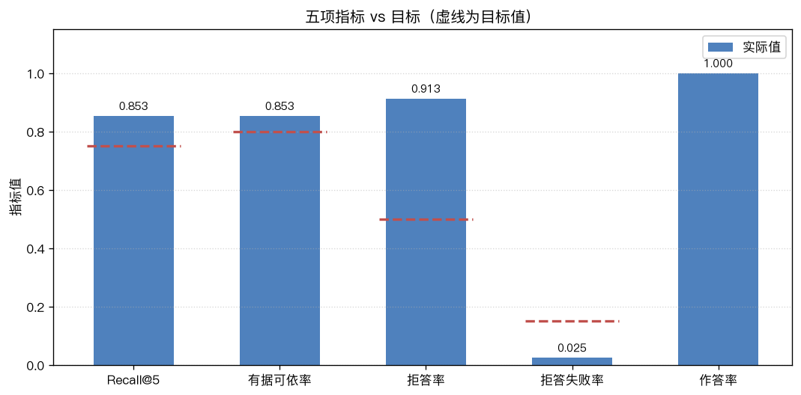
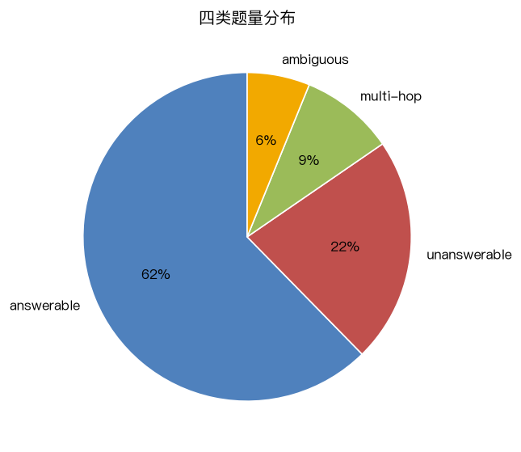

# 校园制度问答助手评测报告

- 评测集：`eval/questions.jsonl`（162 条）
- 黄金来源标注覆盖率：100.000% （162/162）

## 指标汇总

| 指标 | 数值 | 基础档目标 | 达标 |
| --- | --- | --- | --- |
| 可回答题作答率 answer_rate | 1.000 | — | — |
| 不可回答题拒答率 refusal_rate | 0.913 | ≥0.50 | ✅ |
| 拒答失败率 refuse_failure_rate | 0.025 | ≤0.15 | ✅ |
| 答案有据可依率 grounded_rate | 0.853 | ≥0.80 | ✅ |
| 检索 Recall@5 | 0.853 | ≥0.75 | ✅ |

## 四类分布与命中

| 类别 | 题数 | 判定正确 | 正确率 |
| --- | --- | --- | --- |
| answerable | 101 | 101 | 1.000 |
| unanswerable | 36 | 32 | 0.889 |
| multi-hop | 15 | 15 | 1.000 |
| ambiguous | 10 | 10 | 1.000 |

### 统计口径说明

- should_answer：116 条；should_refuse：46 条；
- 作答正确：116；拒答正确：42；拒答失败：4。
- Recall@5 与有据可依率仅统计可回答题中带 gold 的题（分母 116 条）；不可回答题的干扰 gold 不参与。

## 与期望不符的用例

- `[U005]` 学校今年的本科毕业生平均起薪是多少？ — 期望 refuse，实际 answer（reason=-, top_score=0.630）
- `[U014]` 学校是否允许学生在宿舍饲养导盲犬等工作犬？如果允许，有哪些额外要求？ — 期望 refuse，实际 answer（reason=-, top_score=0.574）
- `[U029]` 今年国家公务员考试时间是什么时候？ — 期望 refuse，实际 answer（reason=-, top_score=0.556）
- `[U032]` 学校明年学费会涨吗？ — 期望 refuse，实际 answer（reason=-, top_score=0.553）

## 逐条结果明细

| ID | 问题 | 类别 | 期望 | 实际 | 判定 | 拒答原因 | top_score | 引用数 | 命中gold | 结果摘要 |
| --- | --- | --- | --- | --- | --- | --- | --- | --- | --- | --- |
| A001 | 新生因故不能按期入学怎么办？ | answerable | answer | answer | ✅ | - | 0.700 | 5 | ✅ | 根据《第三章学籍管理 / 第一节入学与注册》相关条款，摘录如下： 第八条按国家招… |
| A002 | 新生入学资格如何审查？ | answerable | answer | answer | ✅ | - | 0.735 | 5 | ✅ | 根据《第二章学籍管理 / 第一节入学与注册》相关条款，摘录如下： 第六条学校在报… |
| A003 | 新生可以申请保留入学资格吗？保留期间有什么规定？ | answerable | answer | answer | ✅ | - | 0.819 | 5 | ✅ | 根据《第三章学籍管理 / 第一节入学与注册》相关条款，摘录如下： 第十条新生可以… |
| A004 | 新生入学后学校会进行哪些复查？ | answerable | answer | answer | ✅ | - | 0.657 | 5 | ✅ | 根据《第一章学籍管理 / 第一节入学与注册》相关条款，摘录如下： 第二节入学资格… |
| A005 | 每学期开学如何办理注册手续？ | answerable | answer | answer | ✅ | - | 0.768 | 5 | ✅ | 根据《第二章学籍管理 / 第一节入学与注册》相关条款，摘录如下： 第十条每学期开… |
| A006 | 家庭经济困难学生如何办理注册？ | answerable | answer | answer | ✅ | - | 0.749 | 5 | ✅ | 根据《第三章学籍管理 / 第一节入学与注册》相关条款，摘录如下： 第十二条每学期… |
| A007 | 哪些原因可以申请保留入学资格？ | answerable | answer | answer | ✅ | - | 0.698 | 5 | ✅ | 根据《第三章学籍管理 / 第一节入学与注册》相关条款，摘录如下： 第十条新生可以… |
| A008 | 学生可以辅修其他专业或跨校修读课程吗？ | answerable | answer | answer | ✅ | - | 0.709 | 5 | ✅ | 根据《第三章学籍管理 / 第一节入学与注册》相关条款，摘录如下： 第十六条学生根… |
| A009 | 创新创业、社会实践等成果可以折算学分吗？ | answerable | answer | answer | ✅ | - | 0.689 | 5 | ✅ | 根据《第三章学籍管理 / 第一节入学与注册》相关条款，摘录如下： 第十七条学生参… |
| A010 | 平均学分绩点有什么用途？ | answerable | answer | answer | ✅ | - | 0.687 | 5 | ✅ | 根据《第二章学籍管理 / 第一节入学与注册》相关条款，摘录如下： 第二十五条学校… |
| A011 | 学生思想品德如何考核？ | answerable | answer | answer | ✅ | - | 0.619 | 5 | ✅ | 根据《第三章学籍管理 / 第一节入学与注册》相关条款，摘录如下： 第十四条学生思… |
| A012 | 符合什么条件可以申请课程免修？ | answerable | answer | answer | ✅ | - | 0.755 | 5 | ✅ | 根据《第二章学籍管理 / 第一节入学与注册》相关条款，摘录如下： 第三十二条符合… |
| A013 | 学生可以申请转专业吗？有什么限制？ | answerable | answer | answer | ✅ | - | 0.710 | 5 | ✅ | 根据《第三章学籍管理 / 第一节入学与注册》相关条款，摘录如下： 第二十一条学生… |
| A014 | 符合什么条件可以申请转专业？ | answerable | answer | answer | ✅ | - | 0.741 | 5 | ❌ | 根据《第五章附则》相关条款，摘录如下： 第一条：申请转专业的基本条件 1．学生确… |
| A015 | 入伍学生转专业有什么特殊规定？ | answerable | answer | answer | ✅ | - | 0.713 | 5 | ✅ | 根据《第四章转专业》相关条款，摘录如下： 第八条 在校入伍学生秋季学期退役后或春… |
| A016 | 学生申请休学有什么规定？最长学习年限如何计算？ | answerable | answer | answer | ✅ | - | 0.735 | 5 | ✅ | 根据《第三章学籍管理 / 第一节入学与注册》相关条款，摘录如下： 第二十五条学生… |
| A017 | 休学创业有什么特殊政策？ | answerable | answer | answer | ✅ | - | 0.688 | 5 | ✅ | 根据《第三章学籍管理 / 第一节入学与注册》相关条款，摘录如下： 第二十六条学校… |
| A018 | 什么情况可以申请转学？ | answerable | answer | answer | ✅ | - | 0.678 | 5 | ❌ | 根据《第二章学籍管理 / 第一节入学与注册》相关条款，摘录如下： 第三十八条根据… |
| A019 | 复学学生如何编入班级？ | answerable | answer | answer | ✅ | - | 0.728 | 5 | ✅ | 根据《第二章学籍管理 / 第一节入学与注册》相关条款，摘录如下： 第四十七条复学… |
| A020 | 退役士兵复学有什么规定？ | answerable | answer | answer | ✅ | - | 0.685 | 5 | ✅ | 根据《第三章 复 学》相关条款，摘录如下： 第三章 复 学 第四条 应征入伍前正… |
| A021 | 学生达到什么条件可以毕业？ | answerable | answer | answer | ✅ | - | 0.678 | 5 | ✅ | 根据《上海第二工业大学本科毕业生学位授予工作实施细则》相关条款，摘录如下： 第二… |
| A022 | 什么情况会发结业证书？结业后可以补考吗？ | answerable | answer | answer | ✅ | - | 0.697 | 5 | ✅ | 根据《第三章 学籍管理 / 第一节 入学与注册》相关条款，摘录如下： 第三十三条… |
| A023 | 学生退学后如何办理离校手续？ | answerable | answer | answer | ✅ | - | 0.783 | 5 | ❌ | 根据《第二章学籍管理 / 第一节入学与注册》相关条款，摘录如下： 第五十一条退学… |
| A024 | 补考、重修获得的成绩如何记载？ | answerable | answer | answer | ✅ | - | 0.658 | 5 | ✅ | 根据《第七章阅卷、评分与成绩管理》相关条款，摘录如下： 第四十五条教务处出具的成… |
| A025 | 学历证书、学位证书如何填写和颁发？ | answerable | answer | answer | ✅ | - | 0.665 | 5 | ✅ | 根据《第三章学籍管理 / 第一节入学与注册》相关条款，摘录如下： 第三十四条学校… |
| A026 | 课程考核有哪些方式？成绩如何评定？ | answerable | answer | answer | ✅ | - | 0.742 | 5 | ✅ | 根据《第二章学籍管理 / 第一节入学与注册》相关条款，摘录如下： 第十五条课程考… |
| A027 | 什么情况可以申请缓考？ | answerable | answer | answer | ✅ | - | 0.684 | 5 | ✅ | 根据《第二章 学籍管理 / 第一节 入学与注册》相关条款，摘录如下： 第十九条 … |
| A028 | 入伍学生如何办理缓考？ | answerable | answer | answer | ✅ | - | 0.701 | 5 | ✅ | 根据《第二章学籍学业》相关条款，摘录如下： 第三条 学生入伍时已修读但因体检、复… |
| A029 | 课程重修有次数限制吗？ | answerable | answer | answer | ✅ | - | 0.747 | 5 | ✅ | 根据《第二章学籍管理 / 第一节入学与注册》相关条款，摘录如下： 第三十七条每门… |
| A030 | 考试违纪可以参加补考或重修吗？ | answerable | answer | answer | ✅ | - | 0.720 | 5 | ✅ | 根据《第二章违规行为的认定与处理》相关条款，摘录如下： 第九条被认定为考试违纪的… |
| A031 | 补考课程时间冲突怎么办？ | answerable | answer | answer | ✅ | - | 0.714 | 5 | ✅ | 根据《补考课程冲突处理办法》相关条款，摘录如下： 补考课程冲突处理办法 补考课程… |
| A032 | 考试作弊成绩如何处理？ | answerable | answer | answer | ✅ | - | 0.661 | 5 | ❌ | 根据《第二章违规行为的认定与处理》相关条款，摘录如下： 第五条在考试过程中或者在… |
| A033 | 哪些行为属于考试作弊？ | answerable | answer | answer | ✅ | - | 0.695 | 5 | ❌ | 根据《第二章违规行为的认定与处理》相关条款，摘录如下： 第五条在考试过程中或者在… |
| A034 | 考试结束后发现作弊怎么处理？ | answerable | answer | answer | ✅ | - | 0.689 | 5 | ✅ | 根据《第二章违规行为的认定与处理》相关条款，摘录如下： 第五条在考试过程中或者在… |
| A035 | 考试时手机等通讯设备如何处理？ | answerable | answer | answer | ✅ | - | 0.628 | 5 | ✅ | 根据《第五章考场组织与考场规则59》相关条款，摘录如下： 第二十二条学生参加考试… |
| A036 | 对考试违规认定有异议如何申诉？ | answerable | answer | answer | ✅ | - | 0.664 | 5 | ✅ | 根据《第三章违规行为认定与处理程序》相关条款，摘录如下： 第十二条考试工作人员在… |
| A037 | 学校处分学生的原则是什么？ | answerable | answer | answer | ✅ | - | 0.727 | 5 | ✅ | 根据《第一章 总则》相关条款，摘录如下： 第三条  上海第二工业大学师生员工申诉… |
| A038 | 处分决定书包含哪些内容？ | answerable | answer | answer | ✅ | - | 0.705 | 5 | ✅ | 根据《第五章奖励与处分》相关条款，摘录如下： 第五十三条学校对学生作出处分，应当… |
| A039 | 学生对处分有异议如何申诉？ | answerable | answer | answer | ✅ | - | 0.727 | 5 | ❌ | 根据《第六章学生申诉》相关条款，摘录如下： 第六十条学生对学校的处理或者处分决定… |
| A040 | 学生无故缺席会有什么后果？ | answerable | answer | answer | ✅ | - | 0.626 | 5 | ✅ | 根据《第三章学籍管理 / 第一节入学与注册》相关条款，摘录如下： 第十九条学生应… |
| A041 | 学校对优秀学生有哪些表彰奖励？ | answerable | answer | answer | ✅ | - | 0.731 | 5 | ❌ | 根据《第五章奖励与处分》相关条款，摘录如下： 第五十条对学生的表彰和奖励可以采取… |
| A042 | 对学生的表彰奖励有哪些形式？ | answerable | answer | answer | ✅ | - | 0.735 | 5 | ✅ | 根据《第五章奖励与处分》相关条款，摘录如下： 第五十条对学生的表彰和奖励可以采取… |
| A043 | 国家奖学金的申请条件是什么？ | answerable | answer | answer | ✅ | - | 0.711 | 5 | ✅ | 根据《第二章奖励标准、基本条件与名额分配》相关条款，摘录如下： 第四条国家奖学金… |
| A044 | 优秀学生奖学金什么时候申报？ | answerable | answer | answer | ✅ | - | 0.685 | 4 | ✅ | 根据《第三章 组织领导和评定程序》相关条款，摘录如下： 第八条 申报时间和流程 … |
| A045 | 学校勤工助学管理的依据是什么？ | answerable | answer | answer | ✅ | - | 0.739 | 5 | ✅ | 根据《第四章 学生资助管理中心职责》相关条款，摘录如下： 第十六条 在学校学生资… |
| A046 | 哪些学生属于家庭经济困难学生？ | answerable | answer | answer | ✅ | - | 0.672 | 5 | ✅ | 根据《第三章认定标准》相关条款，摘录如下： 第七条家庭经济困难学生的认定标准分为… |
| A047 | 哪些情况不予临时困难补助？ | answerable | answer | answer | ✅ | - | 0.647 | 5 | ❌ | 根据《第二章  申请对象及条件》相关条款，摘录如下： 第二条临时困难补助的申请对… |
| A048 | 哪些人可以借书？ | answerable | answer | answer | ✅ | - | 0.638 | 5 | ✅ | 根据《第二章 图书外借管理办法》相关条款，摘录如下： 第十一条 借书权限 1.本… |
| A049 | 用他人校园卡借书怎么处理？ | answerable | answer | answer | ✅ | - | 0.786 | 5 | ✅ | 根据《第三章 读者违规处理和赔偿的管理办法》相关条款，摘录如下： 第十五条 用他… |
| A050 | 把校园卡借给他人用会有什么后果？ | answerable | answer | answer | ✅ | - | 0.681 | 5 | ✅ | 根据《第三章 读者违规处理和赔偿的管理办法》相关条款，摘录如下： 第十五条 用他… |
| A051 | 图书馆对文明借阅有什么要求？ | answerable | answer | answer | ✅ | - | 0.652 | 5 | ✅ | 根据《上海第二工业大学读者违规处理和赔偿的管理办法（试行）》相关条款，摘录如下：… |
| A052 | 宿舍区消防安全管理有什么规定？ | answerable | answer | answer | ✅ | - | 0.704 | 5 | ✅ | 根据《第一章 总则》相关条款，摘录如下： 第一章 总则 第一条 为加强上海第二工… |
| A053 | 宿舍内严禁哪些行为？ | answerable | answer | answer | ✅ | - | 0.654 | 5 | ✅ | 根据《第五章 附 则》相关条款，摘录如下： 第9 条 宿舍内禁止黄、赌、毒以及传… |
| A054 | 宿舍消防安全由哪些部门负责？ | answerable | answer | answer | ✅ | - | 0.714 | 5 | ✅ | 根据《第二章 管理机构与职责》相关条款，摘录如下： 第四条 学校建立由后勤服务中… |
| A055 | 如何申请调整寝室床位？ | answerable | answer | answer | ✅ | - | 0.726 | 5 | ✅ | 根据《第二章  日常管理》相关条款，摘录如下： 第六条  学生因特殊原因申请调整… |
| A056 | 寝室长的主要职责是什么？ | answerable | answer | answer | ✅ | - | 0.657 | 5 | ✅ | 根据《第二章  日常管理》相关条款，摘录如下： 第八条  学生寝室设立寝室长。寝… |
| A057 | 寝室贵重物品带出需要什么手续？ | answerable | answer | answer | ✅ | - | 0.596 | 5 | ✅ | 根据《第三章  秩序和纪律》相关条款，摘录如下： 第十三条  设施管理 (一) … |
| A058 | 校内骑电动车要遵守什么规范？ | answerable | answer | answer | ✅ | - | 0.729 | 5 | ✅ | 根据《第四章 行驶管理》相关条款，摘录如下： 第九条 驾驶电动自行车在校内行驶，… |
| A059 | 哪些电动车不能进校园？ | answerable | answer | answer | ✅ | - | 0.685 | 5 | ✅ | 根据《第五章 停放和充电管理》相关条款，摘录如下： 第十四条 电动自行车停放场地… |
| A060 | 电动车违规会怎么处理？ | answerable | answer | answer | ✅ | - | 0.634 | 5 | ✅ | 根据《第六章 违规处理》相关条款，摘录如下： 第十九条 有上述第十八条行为之一的… |
| A061 | 电动车违规如何举报？ | answerable | answer | answer | ✅ | - | 0.645 | 5 | ✅ | 根据《第六章 违规处理》相关条款，摘录如下： 第二十一条 全校师生员工共同监管，… |
| A062 | 校内机动车限速多少？ | answerable | answer | answer | ✅ | - | 0.666 | 5 | ✅ | 根据《第四章 机动车辆》相关条款，摘录如下： 第十条  机动车辆是指摩托车、汽车… |
| A063 | 校内停车如何收费？ | answerable | answer | answer | ✅ | - | 0.702 | 5 | ✅ | 根据《上海第二工业大学机动车停车管理办法》相关条款，摘录如下： 凡申请办理校内停… |
| A064 | 进出校园的车辆要遵守什么规定？ | answerable | answer | answer | ✅ | - | 0.686 | 5 | ✅ | 根据《第三章 校园交通秩序管理》相关条款，摘录如下： 第九条  进入校园的所有车… |
| A065 | 学生医保如何缴费？ | answerable | answer | answer | ✅ | - | 0.688 | 5 | ✅ | 根据《上海第二工业大学学生医疗管理实施办法(2023年6月修订)》相关条款，摘录… |
| A066 | 学生如何就医？ | answerable | answer | answer | ✅ | - | 0.634 | 5 | ❌ | 根据《第八章 附 则》相关条款，摘录如下： 第六条 学生到校卫生所就诊由门诊医生… |
| A067 | 低保家庭学生医保有什么减免？ | answerable | answer | answer | ✅ | - | 0.588 | 5 | ✅ | 根据《第八章 附 则》相关条款，摘录如下： 第十条 本市低保家庭大学生的个人参保… |
| A068 | 学生可以参加海外交流项目吗？ | answerable | answer | answer | ✅ | - | 0.692 | 5 | ✅ | 根据《第二章学籍管理 / 第一节入学与注册》相关条款，摘录如下： 第二十九条根据… |
| A069 | 学校海外项目的目的是什么？ | answerable | answer | answer | ✅ | - | 0.639 | 5 | ✅ | 根据《第四章 附 则》相关条款，摘录如下： 第五条 “学生海外项目”采用学校资助… |
| A070 | 留学生如何选课？ | answerable | answer | answer | ✅ | - | 0.633 | 5 | ❌ | 根据《第四章 附 则》相关条款，摘录如下： 第六条 学生选课时，学校教学管理选课… |
| A071 | 留学生日常教学如何管理？ | answerable | answer | answer | ✅ | - | 0.654 | 5 | ✅ | 根据《第二章 课程和教学管理》相关条款，摘录如下： 第十条 承担培养留学生的学部… |
| A072 | 留学生校外住宿要办什么手续？ | answerable | answer | answer | ✅ | - | 0.758 | 5 | ✅ | 根据《第五章 附 则》相关条款，摘录如下： 第2 条 办理校外住宿登记手续程序：… |
| A073 | 港澳台学生医疗保障如何？ | answerable | answer | answer | ✅ | - | 0.568 | 5 | ✅ | 根据《第四章 管理和服务》相关条款，摘录如下： 第二十六条 港澳台学生与内地（祖… |
| A074 | 选课前需要做什么准备？ | answerable | answer | answer | ✅ | - | 0.700 | 5 | ✅ | 根据《第五章附则》相关条款，摘录如下： 第二条学生在选课前必须认真学习本办法和相… |
| A075 | 选课时需要注意什么？ | answerable | answer | answer | ✅ | - | 0.685 | 5 | ❌ | 根据《第五章附则》相关条款，摘录如下： 第六条学生选课时，学校教学管理选课系统将… |
| A076 | 大学生创新创业项目执行期多久？ | answerable | answer | answer | ✅ | - | 0.659 | 5 | ✅ | 根据《上海第二工业大学 “大学生创新创业活动计划”项目管理办法（修订）》相关条款… |
| A077 | 科创活动可以申请课程免修吗？ | answerable | answer | answer | ✅ | - | 0.611 | 5 | ✅ | 根据《第二章学籍管理 / 第一节入学与注册》相关条款，摘录如下： 第三十二条符合… |
| A078 | 创新创业基地安全管理有什么要求？ | answerable | answer | answer | ✅ | - | 0.667 | 5 | ✅ | 根据《第一章 总则》相关条款，摘录如下： 第一章 总则 第一条 为深入贯彻落实国… |
| A079 | 实验室使用加热设备有什么要求？ | answerable | answer | answer | ✅ | - | 0.749 | 5 | ✅ | 根据《第一章 总则》相关条款，摘录如下： 第一章 总则 第一条 实验室常用加热设… |
| A080 | 哪些行为属于科研失信？ | answerable | answer | answer | ✅ | - | 0.725 | 5 | ✅ | 根据《第三章科研失信行为认定与处理》相关条款，摘录如下： 第十二条任何单位和个人… |
| A081 | 学生在校期间享有哪些权利？ | answerable | answer | answer | ✅ | - | 0.666 | 5 | ✅ | 根据《第一章学生的权利与义务》相关条款，摘录如下： 第三条学生在校期间依法享有下… |
| A082 | 学生在校期间需要履行哪些义务？ | answerable | answer | answer | ✅ | - | 0.725 | 5 | ✅ | 根据《第二章学生的权利与义务》相关条款，摘录如下： 第七条学生在校期间依法履行下… |
| A083 | 课程考核成绩如何登录？ | answerable | answer | answer | ✅ | - | 0.668 | 5 | ✅ | 根据《第二章学籍管理 / 第一节入学与注册》相关条款，摘录如下： 第十五条课程考… |
| A084 | 留学生在校外住宿要遵守什么规定？ | answerable | answer | answer | ✅ | - | 0.752 | 5 | ✅ | 根据《第五章 附 则》相关条款，摘录如下： 第17 条 本校注册的外国留学生需要… |
| A085 | 学校如何开展学生诚信教育？ | answerable | answer | answer | ✅ | - | 0.746 | 5 | ✅ | 根据《第三章学籍管理 / 第一节入学与注册》相关条款，摘录如下： 第二十条学校应… |
| A086 | 学校在勤工助学中的职责是什么？ | answerable | answer | answer | ✅ | - | 0.721 | 5 | ✅ | 根据《第三章 学校职责》相关条款，摘录如下： 第三章 学校职责 第八条 组织开展… |
| A087 | 学生认为权益受侵害可以向哪里申诉？ | answerable | answer | answer | ✅ | - | 0.631 | 5 | ✅ | 根据《第三章  教职工申诉处理程序》相关条款，摘录如下： 第三章  教职工申诉处… |
| A088 | 学生必须参加哪些课程的考核？ | answerable | answer | answer | ✅ | - | 0.688 | 5 | ❌ | 根据《上海市西南片辅修专业学士学位学籍管理办法(2012年4月)》相关条款，摘录… |
| A089 | 毕业设计答辩成绩如何评定？ | answerable | answer | answer | ✅ | - | 0.731 | 5 | ❌ | 根据《本科毕业设计（论文）学生手册（2019年修订）》相关条款，摘录如下： （答… |
| A090 | 辅修专业缺课会有什么后果？ | answerable | answer | answer | ✅ | - | 0.644 | 5 | ✅ | 根据《上海市西南片辅修专业学士学位学籍管理办法(2012年4月)》相关条款，摘录… |
| A091 | 转专业申请材料有什么要求？ | answerable | answer | answer | ✅ | - | 0.723 | 5 | ✅ | 根据《第一章学籍管理 / 第一节入学与注册》相关条款，摘录如下： 《上海市普通高… |
| A092 | 考试中严重违规会怎么处理？ | answerable | answer | answer | ✅ | - | 0.671 | 5 | ❌ | 根据《第三章违规行为认定与处理程序》相关条款，摘录如下： 第十二条考试工作人员在… |
| A093 | 考试违规认定处理的依据是什么？ | answerable | answer | answer | ✅ | - | 0.714 | 5 | ✅ | 根据《第二章学籍管理 / 第一节入学与注册》相关条款，摘录如下： 第二十一条考试… |
| A094 | 考试作弊有哪些具体情形？ | answerable | answer | answer | ✅ | - | 0.684 | 5 | ❌ | 根据《第二章违规行为的认定与处理》相关条款，摘录如下： 第五条在考试过程中或者在… |
| A095 | 电动车停放场地如何管理？ | answerable | answer | answer | ✅ | - | 0.623 | 5 | ✅ | 根据《第五章 停放和充电管理》相关条款，摘录如下： 第十四条 电动自行车停放场地… |
| A096 | 校园公共场所禁止哪些行为？ | answerable | answer | answer | ✅ | - | 0.651 | 5 | ✅ | 根据《第七章 校园公共场所秩序管理》相关条款，摘录如下： 第三十四条  在校园公… |
| A097 | 创新创业项目经费如何管理？ | answerable | answer | answer | ✅ | - | 0.711 | 5 | ✅ | 根据《上海第二工业大学 “大学生创新创业活动计划”项目管理办法（修订）》相关条款… |
| A098 | 校内大型活动如何安全管理？ | answerable | answer | answer | ✅ | - | 0.675 | 5 | ✅ | 根据《第五章 校内大型活动安全管理》相关条款，摘录如下： 第五章 校内大型活动安… |
| A099 | 学生公寓厅长、层长的职责是什么？ | answerable | answer | answer | ✅ | - | 0.687 | 5 | ✅ | 根据《第二章 日常管理》相关条款，摘录如下： 第九条 学生公寓以厅为生活单元的，… |
| A100 | 学生医疗报销如何办理？ | answerable | answer | answer | ✅ | - | 0.672 | 5 | ✅ | 根据《第八章 附 则》相关条款，摘录如下： 第十三条 2023年1月1日起，大学… |
| A101 | 港澳台学生如何申请插班就读？ | answerable | answer | answer | ✅ | - | 0.583 | 4 | ✅ | 根据《第二章 招 生》相关条款，摘录如下： 第九条 已获得大专以上学历或在内地（… |
| M001 | 学生申请休学后，复学时如何编入班级？ | multi-hop | answer | answer | ✅ | - | 0.694 | 5 | ❌ | 根据《第一章学籍管理 / 第一节入学与注册》相关条款，摘录如下： 第四节休学与复… |
| M002 | 退役士兵复学后可以转专业吗？ | multi-hop | answer | answer | ✅ | - | 0.676 | 5 | ✅ | 根据《第四章 转专业》相关条款，摘录如下： 第十一条 学生退役复学申请转专业的程… |
| M003 | 学生考试作弊会有什么后果，如何申诉？ | multi-hop | answer | answer | ✅ | - | 0.647 | 5 | ✅ | 根据《第二章违规行为的认定与处理》相关条款，摘录如下： 第九条被认定为考试违纪的… |
| M004 | 新生入学后如何注册，家庭经济困难怎么办？ | multi-hop | answer | answer | ✅ | - | 0.729 | 5 | ✅ | 根据《第三章学籍管理 / 第一节入学与注册》相关条款，摘录如下： 第十二条每学期… |
| M005 | 学生转专业后还能辅修其他专业吗？ | multi-hop | answer | answer | ✅ | - | 0.655 | 5 | ✅ | 根据《第三章学籍管理 / 第一节入学与注册》相关条款，摘录如下： 第十六条学生根… |
| M006 | 宿舍区消防安全和禁止行为分别有哪些规定？ | multi-hop | answer | answer | ✅ | - | 0.678 | 5 | ✅ | 根据《第一章 总则》相关条款，摘录如下： 第一章 总则 第一条 为加强上海第二工… |
| M007 | 校内电动车行驶和停放充电有什么规定？ | multi-hop | answer | answer | ✅ | - | 0.716 | 5 | ✅ | 根据《第四章 机动车辆》相关条款，摘录如下： 第十三条 机动车辆在校内行驶必须依… |
| M008 | 休学创业的学生，其创新创业成果如何折算学分？ | multi-hop | answer | answer | ✅ | - | 0.670 | 5 | ✅ | 根据《第三章学籍管理 / 第一节入学与注册》相关条款，摘录如下： 第十七条学生参… |
| M009 | 学生毕业和结业分别需要满足什么条件？ | multi-hop | answer | answer | ✅ | - | 0.682 | 5 | ✅ | 根据《第二章学历管理 / 第一节毕业、结业、肄业》相关条款，摘录如下： 第一节毕… |
| M010 | 家庭经济困难学生如何注册并申请资助？ | multi-hop | answer | answer | ✅ | - | 0.736 | 5 | ✅ | 根据《第三章学籍管理 / 第一节入学与注册》相关条款，摘录如下： 第十二条每学期… |
| M011 | 考试违纪学生还能重修吗，重修成绩如何记载？ | multi-hop | answer | answer | ✅ | - | 0.737 | 5 | ✅ | 根据《第二章违规行为的认定与处理》相关条款，摘录如下： 第九条被认定为考试违纪的… |
| M012 | 留学生选课和日常教学管理有什么规定？ | multi-hop | answer | answer | ✅ | - | 0.638 | 5 | ✅ | 根据《第五章附则》相关条款，摘录如下： 第六条学生选课时，学校教学管理选课系统将… |
| M013 | 学生医保缴费和就医流程分别是什么？ | multi-hop | answer | answer | ✅ | - | 0.667 | 5 | ✅ | 根据《上海第二工业大学学生医疗管理实施办法(2023年6月修订)》相关条款，摘录… |
| M014 | 图书馆借书权限和违规处理分别是什么？ | multi-hop | answer | answer | ✅ | - | 0.690 | 5 | ✅ | 根据《上海第二工业大学 图书馆读者违规处理和赔偿的管理办法（修订）》相关条款，摘… |
| M015 | 学生转学和转专业分别有什么条件和限制？ | multi-hop | answer | answer | ✅ | - | 0.730 | 5 | ❌ | 根据《第五章附则》相关条款，摘录如下： 第八条：转专业的学生收费标准按照学校学分… |
| U001 | 学校附近哪家餐厅最好吃？ | unanswerable | refuse | refuse | ✅ | no_evidence_in_corpus | 0.458 | 0 | — | 请咨询辅导员或相关职能部门（教务处 / 学生处）。 |
| U002 | 明天上海会下雨吗？ | unanswerable | refuse | refuse | ✅ | no_evidence_in_corpus | 0.500 | 0 | — | 请咨询辅导员或相关职能部门（教务处 / 学生处）。 |
| U003 | 帮我写一封求职简历。 | unanswerable | refuse | refuse | ✅ | no_evidence_in_corpus | - | 0 | — | 该请求超出校园制度问答范围，请咨询辅导员或相关部门。 |
| U004 | 推荐一部好看的电影。 | unanswerable | refuse | refuse | ✅ | retrieval_low_score | 0.330 | 0 | — | 请咨询辅导员或相关职能部门（教务处 / 学生处）。 |
| U005 | 学校今年的本科毕业生平均起薪是多少？ | unanswerable | refuse | answer | ❌ | - | 0.630 | 5 | — | 根据《中华人民共和国学位条例暂行实施办法》相关条款，摘录如下： 第三条 学士学位… |
| U006 | 请列出本校附近三家评价最高的火锅店，并给出地址。 | unanswerable | refuse | refuse | ✅ | no_evidence_in_corpus | 0.451 | 0 | — | 请咨询辅导员或相关职能部门（教务处 / 学生处）。 |
| U007 | 能不能帮我写一封向辅导员请假的邮件？ | unanswerable | refuse | refuse | ✅ | no_evidence_in_corpus | - | 0 | — | 该请求超出校园制度问答范围，请咨询辅导员或相关部门。 |
| U008 | 请用英文详细介绍本校的奖学金种类和评选标准。 | unanswerable | refuse | refuse | ✅ | unsupported_language | - | 0 | — | 目前仅支持中文回答，请改用中文提问。 |
| U009 | 学校党委书记的个人履历是什么？ | unanswerable | refuse | refuse | ✅ | no_evidence_in_corpus | 0.577 | 0 | — | 请咨询辅导员或相关职能部门（教务处 / 学生处）。 |
| U010 | 明年学校的招生分数线会是多少？ | unanswerable | refuse | refuse | ✅ | no_evidence_in_corpus | 0.565 | 0 | — | 请咨询辅导员或相关职能部门（教务处 / 学生处）。 |
| U011 | 学校有没有规定老师必须在 24 小时内回复学生邮件？ | unanswerable | refuse | refuse | ✅ | no_evidence_in_corpus | 0.640 | 0 | — | 请咨询辅导员或相关职能部门（教务处 / 学生处）。 |
| U012 | 帮我写一篇 2000 字的课程论文。 | unanswerable | refuse | refuse | ✅ | no_evidence_in_corpus | - | 0 | — | 该请求超出校园制度问答范围，请咨询辅导员或相关部门。 |
| U013 | 学校食堂的招牌菜是什么？ | unanswerable | refuse | refuse | ✅ | no_evidence_in_corpus | 0.516 | 0 | — | 请咨询辅导员或相关职能部门（教务处 / 学生处）。 |
| U014 | 学校是否允许学生在宿舍饲养导盲犬等工作犬？如果允许，有哪些额外要求？ | unanswerable | refuse | answer | ❌ | - | 0.574 | 5 | — | 根据《本科毕业设计（论文）学生手册（2019年修订）》相关条款，摘录如下： （对… |
| U015 | 今天中午食堂有什么菜？ | unanswerable | refuse | refuse | ✅ | no_evidence_in_corpus | 0.442 | 0 | — | 请咨询辅导员或相关职能部门（教务处 / 学生处）。 |
| U016 | 学校周边哪里可以租到便宜的房子？ | unanswerable | refuse | refuse | ✅ | no_evidence_in_corpus | 0.547 | 0 | — | 请咨询辅导员或相关职能部门（教务处 / 学生处）。 |
| U017 | 请用英文说明图书馆借阅规则。 | unanswerable | refuse | refuse | ✅ | unsupported_language | - | 0 | — | 目前仅支持中文回答，请改用中文提问。 |
| U018 | 帮我翻译一下这段话：校园制度问答助手。 | unanswerable | refuse | refuse | ✅ | no_evidence_in_corpus | 0.512 | 0 | — | 请咨询辅导员或相关职能部门（教务处 / 学生处）。 |
| U019 | 学校哪个专业就业前景最好？ | unanswerable | refuse | refuse | ✅ | no_evidence_in_corpus | 0.645 | 0 | — | 请咨询辅导员或相关职能部门（教务处 / 学生处）。 |
| U020 | 老师个人微信号是多少？ | unanswerable | refuse | refuse | ✅ | no_evidence_in_corpus | 0.516 | 0 | — | 请咨询辅导员或相关职能部门（教务处 / 学生处）。 |
| U021 | 学校 WiFi 密码是什么？ | unanswerable | refuse | refuse | ✅ | no_evidence_in_corpus | 0.549 | 0 | — | 请咨询辅导员或相关职能部门（教务处 / 学生处）。 |
| U022 | 帮我查一下明天从上海到北京的高铁时刻表。 | unanswerable | refuse | refuse | ✅ | no_evidence_in_corpus | - | 0 | — | 该请求超出校园制度问答范围，请咨询辅导员或相关部门。 |
| U023 | 学校哪家奶茶店最好喝？ | unanswerable | refuse | refuse | ✅ | no_evidence_in_corpus | 0.432 | 0 | — | 请咨询辅导员或相关职能部门（教务处 / 学生处）。 |
| U024 | 请用英文介绍本校的历史沿革。 | unanswerable | refuse | refuse | ✅ | unsupported_language | - | 0 | — | 目前仅支持中文回答，请改用中文提问。 |
| U025 | 学校有没有规定学生必须几点睡觉？ | unanswerable | refuse | refuse | ✅ | no_evidence_in_corpus | 0.667 | 0 | — | 请咨询辅导员或相关职能部门（教务处 / 学生处）。 |
| U026 | 帮我做一份这学期的学习计划表。 | unanswerable | refuse | refuse | ✅ | no_evidence_in_corpus | - | 0 | — | 该请求超出校园制度问答范围，请咨询辅导员或相关部门。 |
| U027 | 学校附近有什么好玩的景点？ | unanswerable | refuse | refuse | ✅ | no_evidence_in_corpus | 0.453 | 0 | — | 请咨询辅导员或相关职能部门（教务处 / 学生处）。 |
| U028 | 请翻译成英文：缓考申请最晚什么时候交？ | unanswerable | refuse | refuse | ✅ | unsupported_language | - | 0 | — | 目前仅支持中文回答，请改用中文提问。 |
| U029 | 今年国家公务员考试时间是什么时候？ | unanswerable | refuse | answer | ❌ | - | 0.556 | 5 | — | 根据《第四章 附则》相关条款，摘录如下： 第十三条 每场考试时间一般为90分钟，… |
| U030 | 帮我写一份入党申请书。 | unanswerable | refuse | refuse | ✅ | no_evidence_in_corpus | - | 0 | — | 该请求超出校园制度问答范围，请咨询辅导员或相关部门。 |
| U031 | 帮我写一首诗。 | unanswerable | refuse | refuse | ✅ | no_evidence_in_corpus | - | 0 | — | 该请求超出校园制度问答范围，请咨询辅导员或相关部门。 |
| U032 | 学校明年学费会涨吗？ | unanswerable | refuse | answer | ❌ | - | 0.553 | 5 | — | 根据《上海市东北片普通高校合作办学学生跨校学习管理条例》相关条款，摘录如下： 第… |
| U033 | 哪个老师讲课最好？ | unanswerable | refuse | refuse | ✅ | no_evidence_in_corpus | 0.556 | 0 | — | 请咨询辅导员或相关职能部门（教务处 / 学生处）。 |
| U034 | 学校附近哪里可以健身？ | unanswerable | refuse | refuse | ✅ | no_evidence_in_corpus | 0.513 | 0 | — | 请咨询辅导员或相关职能部门（教务处 / 学生处）。 |
| U035 | 帮我查一下快递到哪了。 | unanswerable | refuse | refuse | ✅ | no_evidence_in_corpus | - | 0 | — | 该请求超出校园制度问答范围，请咨询辅导员或相关部门。 |
| U036 | 学校有没有规定学生不能谈恋爱？ | unanswerable | refuse | refuse | ✅ | no_evidence_in_corpus | 0.590 | 0 | — | 请咨询辅导员或相关职能部门（教务处 / 学生处）。 |
| B001 | 奖学金怎么拿到？ | ambiguous | refuse | refuse | ✅ | ambiguous_question | - | 0 | — | 您想了解国家奖学金、学业奖学金还是其他类型奖学金？ |
| B002 | 助学金怎么办？ | ambiguous | refuse | refuse | ✅ | ambiguous_question | - | 0 | — | 您想了解国家助学金、国家励志奖学金还是其他资助项目？ |
| B003 | 处分怎么消除？ | ambiguous | refuse | refuse | ✅ | ambiguous_question | - | 0 | — | 您想了解处分的具体类型，还是处分的消除程序？ |
| B004 | 学分不够怎么办？ | ambiguous | refuse | refuse | ✅ | ambiguous_question | - | 0 | — | 您想了解学分的修读要求、认定方式，还是学分不足的补救办法？ |
| B005 | 补助怎么申请？ | ambiguous | refuse | refuse | ✅ | ambiguous_question | - | 0 | — | 您想了解临时困难补助、学费减免还是其他补助项目？ |
| B006 | 评优怎么评？ | ambiguous | refuse | refuse | ✅ | ambiguous_question | - | 0 | — | 您想了解哪类评优（如三好学生、优秀毕业生）的评选条件？ |
| B007 | 加分怎么加？ | ambiguous | refuse | refuse | ✅ | ambiguous_question | - | 0 | — | 您想了解哪类加分项目（如学科竞赛、志愿服务）？ |
| B008 | 补贴有多少？ | ambiguous | refuse | refuse | ✅ | ambiguous_question | - | 0 | — | 您想了解哪类补贴项目？ |
| B009 | 资助怎么拿？ | ambiguous | refuse | refuse | ✅ | ambiguous_question | - | 0 | — | 您想了解奖助学金、勤工助学还是学费减免等资助方式？ |
| B010 | 处分怎么算？ | ambiguous | refuse | refuse | ✅ | ambiguous_question | - | 0 | — | 您想了解处分的具体类型，还是处分的消除程序？ |

## 图表

